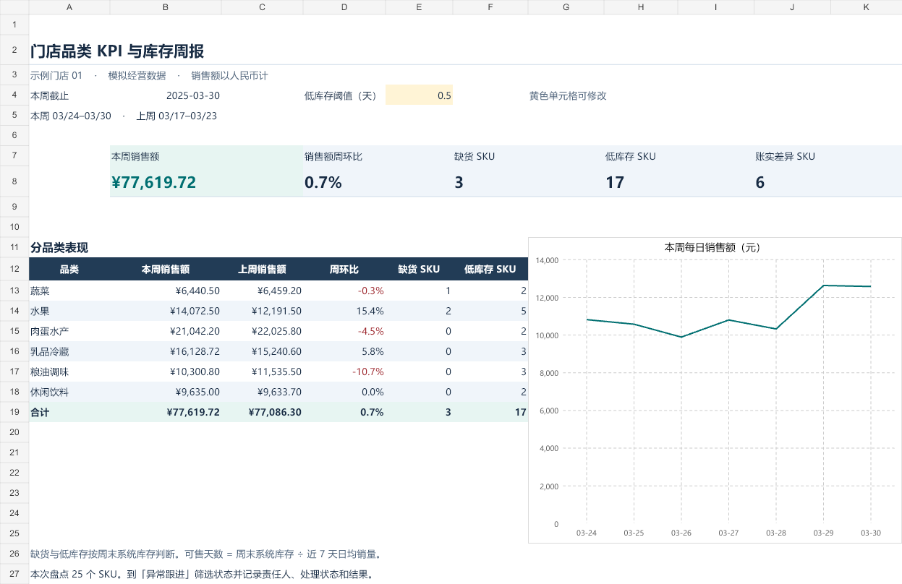

# 门店品类 KPI 与库存周报

一个面向商超库存分析的 Excel 作品。案例覆盖 1 家模拟门店、6 个品类和 60 个商品，用 2025 年 3 月的 1,800 条商品日记录，跟踪品类销售、周末库存和盘点差异。

## 打开项目

1. 下载 [Excel 工作簿](retail-inventory-weekly-report.xlsx)，用 Microsoft Excel 打开。工作簿内含数据和公式。
2. 在「库存周报」查看销售额、周环比和库存风险。将黄色单元格 `E4` 的低库存阈值从 **0.5 天**改成 **1 天**，低库存商品数会从 17 变为 34。
3. 在「异常跟进」按库存状态筛选，或按「实存−账存」筛选非零差异。在黄色列填写负责人、处理状态和结果备注。



## 本周结果

| 指标 | 2025-03-24 至 2025-03-30 |
| --- | ---: |
| 销售额 | ¥77,619.72 |
| 销售额周环比 | +0.69% |
| 周末系统库存为零 | 3 个商品 |
| 周末低库存 | 17 个商品 |
| 盘点账实差异 | 25 个盘点商品中有 6 个 |

水果销售额比上周增长约 15.4%，同时有 2 个商品的周末系统库存为零。蔬菜 `S006` 紫甘蓝的系统库存为 0 千克，盘点实存为 2 千克，跟进时先请仓储复盘并核对出入库，再判断是否需要补货。同一商品可能同时出现在库存和盘点指标中。

## 指标口径

- **周环比**用本周销售额除以上周销售额再减 1。上周为 3 月 17 日至 23 日。品类用销售额汇总，商品销量和库存沿用各自的计量单位。
- **可售天数**用周末系统库存除以近 7 天日均销量。系统库存为 0 时标记缺货。库存为正、近 7 天有销量且可售天数不超过阈值时标记低库存。库存为正且近 7 天销量为 0 时标记无动销。
- **账实差异**用同一时点的盘点实存减系统库存。未盘点商品的实存和差异留空。缺货为周末系统库存的截面指标，补货判断仍需结合在途数量和到货时间。

## 数据来源与复现

本项目使用独立生成的模拟数据。工作簿「每日数据」页保留日期、商品编号、销量、销售额、日末系统库存和日末盘点实存。可用 Python 3 重新生成同一份样本，脚本仅使用标准库。

```bash
python generate_demo_data.py --output report_data.json
```

业务场景参考卡内基梅隆大学 MLIP 的教学案例。周报布局、库存规则、跟进表和模拟样本为本项目实现。 [MLIP 教学案例](https://github.com/mlip-cmu/data-quality/blob/bc2f93b55f81d0b36b06b422f216a5155ed46944/inventory-data/README.md)
